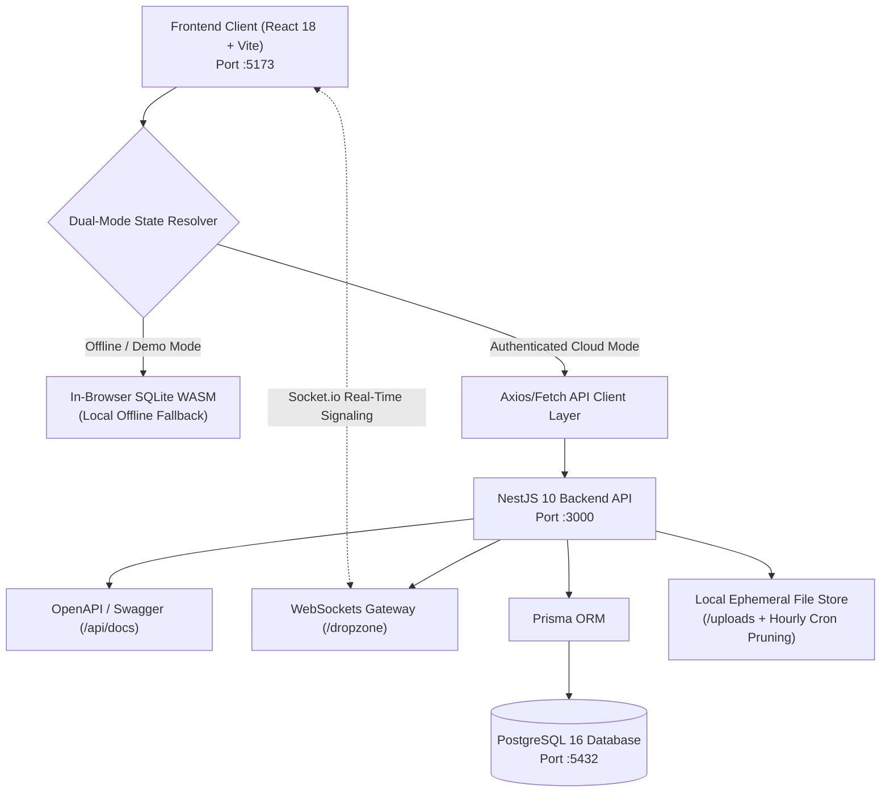

# 🤖 Superapps OS - Fullstack Agentic AI Developer Specification

> **Target Audience**: Autonomous AI Developer Agents (Antigravity, Cursor, Claude Code, Aider, Devin) and Human Lead Engineers.
> **Architecture**: Dual-Mode Fullstack Monorepo (React 18 + Vite Frontend & NestJS 10 + Prisma + PostgreSQL Backend).

---

## 1. Executive Vision & Architecture Map

Superapps OS is a multi-tenant personal productivity and daily utility operating system. It features a modern, clean UI in the frontend paired with an enterprise-grade modular NestJS backend.



### Tech Stack Matrix
| Layer | Technologies | Key Responsibilities |
| :--- | :--- | :--- |
| **Frontend** | React 18, TypeScript, Tailwind CSS, Lucide Icons, Vite | Single-page app, responsive dashboard, dark/light themes, offline-first fallback. |
| **Backend API** | NestJS 10, TypeScript, Express, Swagger | Modular RESTful controllers, DTO validation (`class-validator`), guards. |
| **Database & ORM** | PostgreSQL 16, Prisma ORM | Multi-tenant schema, cascade deletes, relational indexing, automated migrations. |
| **Authentication** | Passport.js, JWT, bcrypt (10 rounds) | Stateless access & refresh tokens, password hashing, user context injection. |
| **Real-Time** | `@nestjs/websockets`, Socket.io | P2P WebRTC room signaling and active connection coordination. |
| **Storage & Jobs** | Multer disk storage, `@nestjs/schedule` | Ephemeral file sharing with automated hourly TTL expiration cron jobs. |
| **Orchestration** | NPM Workspaces, Docker Compose, Concurrently | One-click developer experience (`npm run dev`, `docker compose up -d`). |

---

## 2. Monorepo Directory Organization

```
superapps/
├── .agentrules                     # AI agent operational guidelines & guardrails
├── docker-compose.yml              # PostgreSQL 16 container definition
├── package.json                    # Monorepo root workspace orchestration
├── README.md                       # High-level project documentation
├── docs/                           # Architectural guides & specs
│   ├── ARCHITECTURE.md
│   ├── AI_DEVELOPER_AGENT_SPEC.md  # THIS SPECIFICATION
│   └── DATABASE_SCHEMA.md
├── frontend/                       # Client SPA (React 18 + Vite)
│   ├── index.html
│   ├── package.json
│   ├── vite.config.ts
│   ├── vitest.config.ts
│   ├── tailwind.config.js
│   ├── public/                     # Static assets, WASM binaries, favicon
│   └── src/
│       ├── App.tsx                 # Route declarations & Context Providers
│       ├── components/             # Reusable UI components & Layouts
│       ├── context/                # Auth, DB, Theme, CommandPalette state
│       ├── pages/                  # Page views (Dashboard, Notes, Expenses, etc.)
│       └── services/               # API clients, SQLite WASM, WebCrypto
└── backend/                        # API Server (NestJS 10 + Prisma)
    ├── nest-cli.json
    ├── package.json
    ├── tsconfig.json
    ├── .env.example
    ├── prisma/
    │   └── schema.prisma           # PostgreSQL relational schema
    └── src/
        ├── main.ts                 # Bootstrap, Swagger, ValidationPipe, CORS
        ├── app.module.ts           # Root module & config loading
        ├── prisma/                 # Global PrismaClient wrapper
        └── modules/
            ├── auth/               # JWT & bcrypt authentication
            ├── users/              # User management & profile
            ├── shortlinks/         # Link manager & redirect engine
            ├── notes/              # Markdown notes manager
            ├── expenses/           # Financial transactions & analytics
            ├── habits/             # Daily/weekly habits & streaks
            ├── tasks/              # Kanban/Task tracker
            ├── snippets/           # Code snippet manager
            ├── dropzone/           # File storage & WebRTC WebSocket gateway
            └── settings/           # User key-value preferences
```

---

## 3. Database Schema Contract (Prisma Models)

All models are isolated per user (`userId`), ensuring strict multi-tenant data boundaries:

```prisma
datasource db {
  provider = "postgresql"
  url      = env("DATABASE_URL")
}

model User {
  id           String         @id @default(uuid())
  email        String         @unique
  username     String         @unique
  passwordHash String
  avatarUrl    String?
  createdAt    DateTime       @default(now())
  updatedAt    DateTime       @updatedAt

  refreshTokens RefreshToken[]
  shortlinks    Shortlink[]
  notes         Note[]
  expenses      Expense[]
  habits        Habit[]
  tasks         Task[]
  snippets      Snippet[]
  dropZoneFiles DropZoneFile[]
  appSettings   AppSetting[]
  @@map("users")
}

model Shortlink {
  id        String   @id @default(uuid())
  userId    String
  key       String   @unique
  title     String
  url       String
  category  String?  @default("General")
  clicks    Int      @default(0)
  createdAt DateTime @default(now())
  updatedAt DateTime @updatedAt
  user      User     @relation(fields: [userId], references: [id], onDelete: Cascade)
  @@index([userId])
  @@index([key])
  @@map("shortlinks")
}

model Note {
  id        String   @id @default(uuid())
  userId    String
  title     String
  content   String
  category  String?  @default("General")
  isPinned  Boolean  @default(false)
  createdAt DateTime @default(now())
  updatedAt DateTime @updatedAt
  user      User     @relation(fields: [userId], references: [id], onDelete: Cascade)
  @@index([userId])
  @@map("notes")
}

model Expense {
  id        String   @id @default(uuid())
  userId    String
  title     String
  amount    Float
  type      String   // "income" | "expense"
  category  String   @default("General")
  date      DateTime @default(now())
  notes     String?
  createdAt DateTime @default(now())
  user      User     @relation(fields: [userId], references: [id], onDelete: Cascade)
  @@index([userId])
  @@map("expenses")
}

model Habit {
  id             String   @id @default(uuid())
  userId         String
  title          String
  frequency      String   @default("daily")
  streak         Int      @default(0)
  completedDates String[] @default([]) // Array of YYYY-MM-DD
  createdAt      DateTime @default(now())
  user           User     @relation(fields: [userId], references: [id], onDelete: Cascade)
  @@index([userId])
  @@map("habits")
}

model Task {
  id          String    @id @default(uuid())
  userId      String
  title       String
  description String?
  status      String    @default("todo") // "todo" | "in_progress" | "done"
  priority    String    @default("medium") // "low" | "medium" | "high"
  dueDate     DateTime?
  tags        String[]  @default([])
  checklist   Json?
  createdAt   DateTime  @default(now())
  updatedAt   DateTime  @updatedAt
  user        User      @relation(fields: [userId], references: [id], onDelete: Cascade)
  @@index([userId])
  @@map("tasks")
}

model Snippet {
  id          String   @id @default(uuid())
  userId      String
  title       String
  description String?
  language    String   @default("typescript")
  code        String
  tags        String[] @default([])
  isPinned    Boolean  @default(false)
  createdAt   DateTime @default(now())
  updatedAt   DateTime @updatedAt
  user        User     @relation(fields: [userId], references: [id], onDelete: Cascade)
  @@index([userId])
  @@map("snippets")
}

model DropZoneFile {
  id          String   @id @default(uuid())
  userId      String?
  name        String
  size        Int
  mimeType    String
  storagePath String
  url         String
  isEphemeral Boolean  @default(true)
  expiresAt   DateTime
  createdAt   DateTime @default(now())
  user        User?    @relation(fields: [userId], references: [id], onDelete: SetNull)
  @@index([userId])
  @@index([expiresAt])
  @@map("dropzone_files")
}

model AppSetting {
  id     String @id @default(uuid())
  userId String
  key    String
  value  String
  user   User   @relation(fields: [userId], references: [id], onDelete: Cascade)
  @@unique([userId, key])
  @@map("app_settings")
}
```

---

## 4. REST & WebSocket API Specification

Base URL: `http://localhost:3000/api`
Interactive Documentation: `http://localhost:3000/api/docs`

### Authentication (`/auth`)
| Method | Endpoint | Auth | Description |
| :--- | :--- | :--- | :--- |
| `POST` | `/auth/register` | None | Create user (`email`, `username`, `password`). Returns `{ user, accessToken, refreshToken }`. |
| `POST` | `/auth/login` | None | Authenticate (`login`, `password`). Returns `{ user, accessToken, refreshToken }`. |
| `POST` | `/auth/refresh` | None | Refresh token rotation (`refreshToken`). |
| `GET` | `/auth/me` | Bearer | Get current user session profile. |

### Shortlinks (`/shortlinks`)
| Method | Endpoint | Auth | Description |
| :--- | :--- | :--- | :--- |
| `POST` | `/shortlinks` | Bearer | Create shortlink (`key`, `title`, `url`, `category`). |
| `GET` | `/shortlinks` | Bearer | List current user shortlinks. |
| `GET` | `/shortlinks/:id` | Bearer | Get shortlink by ID. |
| `PUT` | `/shortlinks/:id` | Bearer | Update shortlink. |
| `DELETE` | `/shortlinks/:id` | Bearer | Delete shortlink. |
| `GET` | `/shortlinks/r/:key` | None | Public redirect target. Increments `clicks` counter. |

### Notes (`/notes`)
| Method | Endpoint | Auth | Description |
| :--- | :--- | :--- | :--- |
| `POST` | `/notes` | Bearer | Create Markdown note (`title`, `content`, `category`, `isPinned`). |
| `GET` | `/notes` | Bearer | List notes with optional `?search=` filter. Pinned notes first. |
| `GET` | `/notes/:id` | Bearer | Get single note. |
| `PUT` | `/notes/:id` | Bearer | Update note content/metadata. |
| `DELETE` | `/notes/:id` | Bearer | Delete note. |

### Expenses (`/expenses`)
| Method | Endpoint | Auth | Description |
| :--- | :--- | :--- | :--- |
| `POST` | `/expenses` | Bearer | Create transaction (`title`, `amount`, `type`, `category`, `date`, `notes`). |
| `GET` | `/expenses` | Bearer | List transactions with `?type=` and `?category=` filters. |
| `GET` | `/expenses/summary` | Bearer | Returns `{ totalIncome, totalExpense, netBalance, categoryBreakdown }`. |
| `GET` | `/expenses/:id` | Bearer | Get transaction by ID. |
| `PUT` | `/expenses/:id` | Bearer | Update transaction. |
| `DELETE` | `/expenses/:id` | Bearer | Delete transaction. |

### Habits, Tasks & Snippets
- **Habits** (`/habits`): `POST /`, `GET /`, `POST /:id/toggle`, `DELETE /:id`.
- **Tasks** (`/tasks`): `POST /`, `GET /?status=&priority=`, `GET /:id`, `PUT /:id`, `DELETE /:id`.
- **Snippets** (`/snippets`): `POST /`, `GET /?language=&search=`, `GET /:id`, `PUT /:id`, `DELETE /:id`.

### DropZone & WebRTC Signaling (`/dropzone`)
- **File Upload**: `POST /dropzone/upload` (Multipart form-data: `file`, `expiryHours`).
- **File Access**: `GET /dropzone/file/:filename` (Stream file to browser with correct mime-type).
- **My Files**: `GET /dropzone/my-files` (Bearer auth required).
- **Delete File**: `DELETE /dropzone/file/:id` (Bearer auth required).
- **WebSocket Gateway** (`namespace: /dropzone`):
  - `join-room`: `{ roomId, peerId }` &rarr; emits `peer-joined`.
  - `signal`: `{ roomId, targetPeerId, signalData }` &rarr; emits `signal-received`.
  - `leave-room`: `{ roomId }` &rarr; emits `peer-left`.

---

## 5. Dual-Mode Frontend Integration Protocol

To ensure 100% zero downtime, the frontend uses an adapter pattern:

1. **`frontend/src/services/apiClient.ts`**:
   - Axios or fetch client configured with `baseURL: http://localhost:3000/api`.
   - Automatic `Authorization: Bearer <token>` header injection from `localStorage`.
   - Automatic 401 interceptor attempting token refresh via `/auth/refresh`.
2. **`frontend/src/context/DbContext.tsx` Dual-Mode Resolver**:
   - Checks if user is authenticated with backend (`authToken` exists and `/auth/me` responds).
   - If connected: CRUD operations route to the NestJS API.
   - If offline or unauthenticated: CRUD operations route to local SQLite WASM (`sqliteService.ts`).

---

## 6. Step-by-Step Autonomous AI Agent Roadmap

When prompting an AI coding agent to implement or extend features, follow this phased execution path:

### Milestone 1: Environment & PostgreSQL Spin-up
- Run `docker compose up -d` to boot PostgreSQL.
- Run `npm run db:generate` to compile Prisma client.
- Run `npm run db:migrate` to create database tables.
- Verification: `npm run db:studio` or check database connectivity.

### Milestone 2: Backend Compilation & Test Verification
- Run `npm run build --prefix backend`.
- Ensure zero TypeScript compiler errors (`tsc`).
- Add unit/integration tests in `backend/src/test/` covering Auth, Shortlinks, Notes, and Expenses.
- Run `npm run test --prefix backend`.

### Milestone 3: Frontend API Client Layer
- Implement `frontend/src/services/apiClient.ts`.
- Implement authentication store in `frontend/src/context/AuthContext.tsx` supporting login, registration, and logout against `/api/auth`.

### Milestone 4: Dual-Mode DB Context Synchronization
- Connect `frontend/src/context/DbContext.tsx` to call API endpoints for:
  - Shortlinks
  - Notes
  - Expenses
  - Habits
  - Tasks
  - Snippets
- Keep SQLite WASM as the graceful offline fallback.

### Milestone 5: DropZone WebSockets & File Uploads
- Connect `DropZonePage.tsx` to backend `/api/dropzone/upload`.
- Connect PeerJS room coordination to backend Socket.io `/dropzone` gateway.

### Milestone 6: Fullstack E2E Verification
- Run full test suite: `npm run test`.
- Run Playwright E2E tests: `npm run test:e2e --prefix frontend`.
- Verify fullstack dev server boots cleanly with `npm run dev`.

---

## 7. Autonomous Agent Execution Prompts

Copy and paste these exact prompts to invoke autonomous AI coding agents for specific phases:

### Agent Prompt: Phase 1 (Backend Verification & Migrations)
```markdown
You are an expert NestJS & Prisma AI Backend Developer.
Review .agentrules and docs/AI_DEVELOPER_AGENT_SPEC.md.
Task:
1. Verify backend/prisma/schema.prisma and run Prisma generation.
2. Run backend build check (npm run build --prefix backend).
3. Create unit tests for AuthController, ShortlinksService, and ExpensesService in backend/src/test/.
4. Run npm run test --prefix backend and ensure 100% pass rate.
Do not commit or push. Follow all rules in .agentrules.
```

### Agent Prompt: Phase 2 (Frontend Dual-Mode Integration)
```markdown
You are an expert React 18 & Fullstack TypeScript AI Developer.
Review .agentrules and docs/AI_DEVELOPER_AGENT_SPEC.md.
Task:
1. Create frontend/src/services/apiClient.ts with Axios/Fetch, Bearer token interceptor, and refresh token handling.
2. Update AuthContext.tsx to support backend authentication (login, register, logout, profile fetch) with graceful offline fallback.
3. Update DbContext.tsx to use Dual-Mode: fetch from NestJS API when authenticated, fallback to in-browser SQLite WASM when offline.
4. Verify by running npm run build --prefix frontend and npm run test --prefix frontend.
Do not commit or push. Follow all rules in .agentrules.
```
