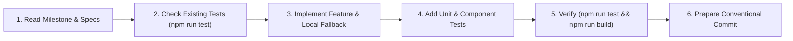

# AI Developer Agent Specification (Superapps)

This specification defines the exact operational guidelines, conventions, and workflows for **Agentic AI assistants** (such as Google Antigravity, Claude Code, Cursor, GitHub Copilot) working autonomously or pair-programming on **Superapps Workspace**.

---

## 1. Prime Directives for AI Agents

1. **Strict Free-Tier Compliance**:
   - Never introduce dependencies, architectures, or services that require paid plans, credit cards, or external compute servers.
   - The application must always be fully deployable to **GitHub Pages** as a static SPA and connect directly to **Firebase Spark** (Auth, Firestore, Storage) via the client SDK.
2. **Never Break Offline / Demo Fallback**:
   - Every feature must continue to function even if `isFirebaseConfigured` is false or the user is in guest mode.
   - Always implement both the Firestore cloud path and the `localStorage` fallback in `src/services/dataService.ts`.
3. **No Unsolicited Broad Refactors**:
   - Maintain existing docstrings, TypeScript types, and comments.
   - Execute tasks cleanly scoped to the active milestone or user request.
4. **Git Safety & Commit Protocol**:
   - Never run `git commit` or `git push` unless the user explicitly instructs you to do so.
   - Formulate commit messages following **Conventional Commits** (`feat:`, `fix:`, `refactor:`, `test:`, `docs:`).

---

## 2. Milestone Execution Framework

When working on a milestone:



### Steps for Each Milestone Task:
1. **Identify the Scope**: Pinpoint which milestone task is being implemented from `docs/DEVELOPER_GUIDE.md#6-milestone-driven-roadmap`.
2. **Update Types**: If new fields or models are introduced, update `src/types/index.ts` first.
3. **Update Data Layer**: Add CRUD and persistence methods to `src/services/dataService.ts`.
4. **Update or Create UI Components**: Implement clean React 19 functional components with Tailwind CSS following the Linear/Raycast design language.
5. **Verify with Vitest & TypeScript**:
   ```bash
   npm run test
   npm run build
   ```
   Both commands must pass with exit code 0 before concluding.

---

## 3. Directory Navigation & Key Files

| Goal | Key File Path |
|---|---|
| Domain Routing & CNAME | `public/CNAME` & `public/404.html` |
| Firebase Client Config | `src/firebase/config.ts` |
| Security Rules | `firestore.rules` & `storage.rules` |
| Auth State & Guest Mode | `src/context/AuthContext.tsx` |
| Data Layer & Local Cache | `src/services/dataService.ts` |
| Command Palette (`Ctrl+K`) | `src/components/palette/CommandPaletteModal.tsx` |
| Application Shell & Navigation | `src/components/layout/AppShell.tsx` |
| Unit Tests | `src/test/dataService.test.ts` & `src/test/App.test.tsx` |
| CI/CD Deployment | `deploy/deploy.yml` |

---

## 4. UI & Accessibility Standards

- **Semantic HTML**: Use proper HTML5 elements (`<aside>`, `<header>`, `<main>`, `<nav>`, `<button>`).
- **Focus Management**: All interactive dialogs (AuthModal, CommandPaletteModal) must handle keyboard dismiss (`Escape`) and trap or release focus cleanly.
- **Theme Support**: Every UI element must provide both light mode (`bg-white`, `text-slate-900`) and dark mode (`dark:bg-slate-900`, `dark:text-slate-100`) classes.
- **Icons**: Exclusively use `lucide-react`.

---

## 5. Verification Checklist for AI Agent Completion

Before reporting completion of any milestone task, verify:
- [ ] `npm run test` exits with code 0 (all test suites pass).
- [ ] `npm run build` exits with code 0 (TypeScript compiles cleanly with `tsc -b`, bundle generated in `dist/`).
- [ ] `dist/CNAME` contains `apps.k31.my.id`.
- [ ] `dist/404.html` exists for GitHub Pages SPA routing.
- [ ] Prepare structured conventional commit draft with concise bulleted file changes.
