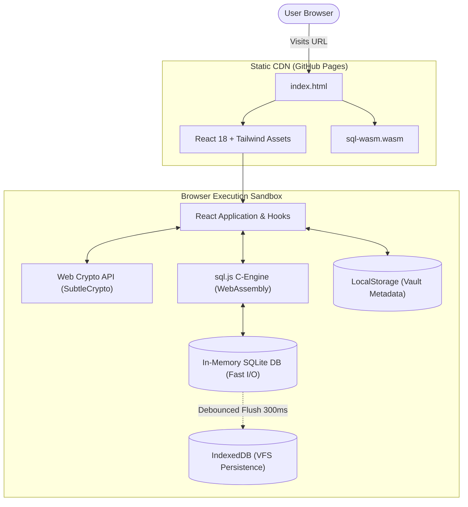
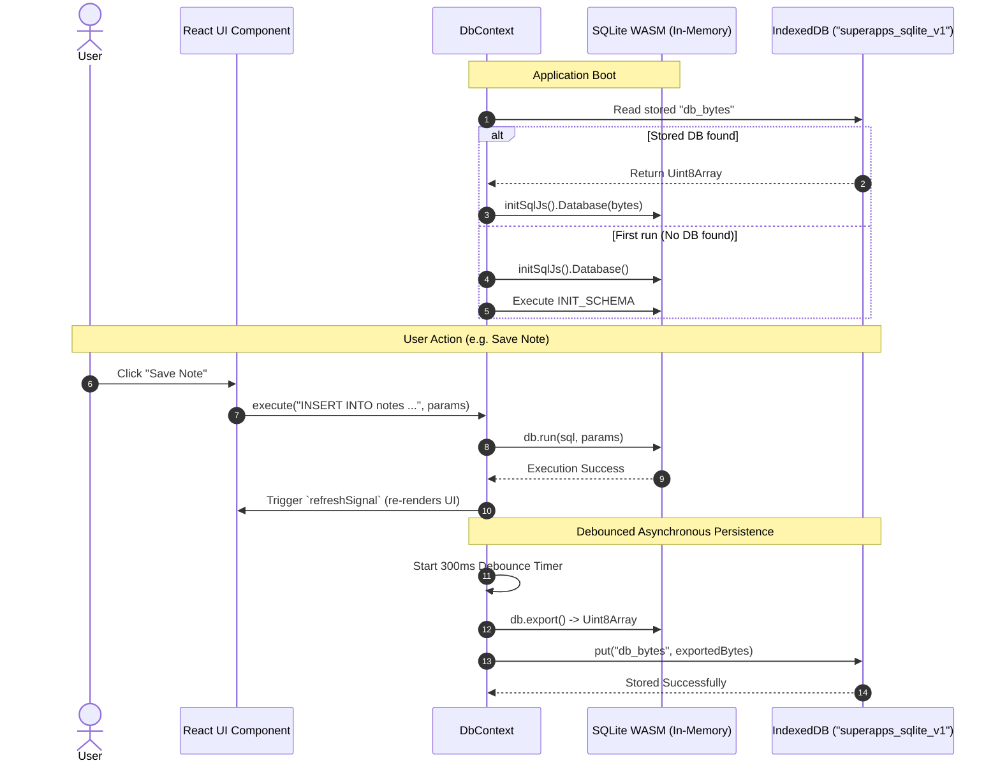
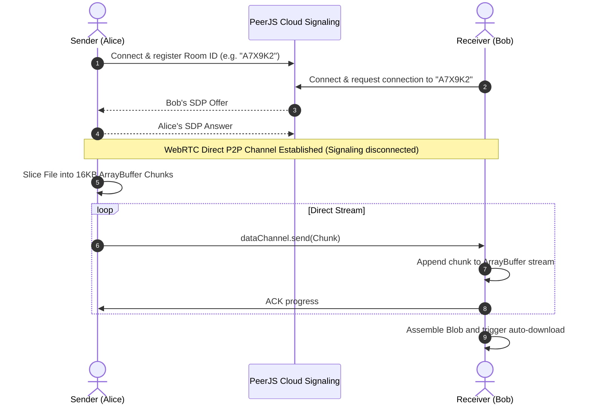

# Superapps OS — Architectural Specification

This document details the architectural blueprints, data flow diagrams, and internal engineering decisions powering **Superapps OS**.

---

## 🏛️ 1. System Topology & Static Hosting Architecture

Superapps OS runs exclusively within the user's web browser. There is **no persistent backend, no remote microservices, and no server-side telemetry**.



### Static Hosting Constraints & Solutions

| Constraint | Architectural Solution |
| :--- | :--- |
| **No server routing (Deep links return 404)** | Adopted `HashRouter` (`/#/...`). The hash fragment is handled entirely on the client, avoiding server route resolution errors. |
| **No server database (MySQL/PostgreSQL)** | Embedded C-SQLite compiled to WebAssembly (`sql.js`). Executes real relational queries entirely inside browser RAM. |
| **Data loss on browser tab refresh** | Implemented an IndexedDB Virtual File System (VFS) bridge that saves the SQLite binary Uint8Array into IndexedDB upon mutation. |
| **No server-side link shortening service** | Implemented Stateless Shortlinks: URL destinations are compressed into the hash fragment via LZ-String (`/#/r?d=...`). |
| **No file hosting server for sharing** | Implemented direct browser-to-browser WebRTC DataChannel streaming with PeerJS signaling. |

---

## 💾 2. In-Browser SQLite Engine & Persistence Lifecycle

Superapps OS uses `sql.js` (SQLite 3.x compiled with Emscripten into WebAssembly).

### The In-Memory + IndexedDB VFS Sync Cycle



### Why this design?
1. **Zero-Latency Reads and Writes**: Queries run against C-speed WebAssembly memory. There is zero asynchronous wait time when querying lists or sorting transactions.
2. **Crash-Resilience**: Debouncing disk writes (300ms) guarantees that rapid-fire typing in the Markdown editor does not bottleneck the IndexedDB transactional queue while guaranteeing prompt persistence.

---

## 🔗 3. Stateless Public Link Architecture

Traditional shortlink systems (Bitly, TinyURL) store pairs `(slug, long_url)` in a centralized SQL database. Superapps OS introduces **Stateless Shortlinks** that require zero database records:

```mermaid
flowchart LR
    LongURL["Long Target URL"] --> Compress["LZ-String CompressToBase64()"]
    Compress --> OptionalEncrypt["(Optional) AES-256-GCM Encrypt"]
    OptionalEncrypt --> URL["https://host/#/r?d=COMPRESSED_PAYLOAD"]

    URL --> Recipient["Recipient Opens URL"]
    Recipient --> HashRouter["/#/r Route (RedirectHandlerPage)"]
    HashRouter --> Decompress["LZ-String DecompressFromBase64()"]
    Decompress --> Navigate["window.location.replace(TargetURL)"]
```



### URL Structure

```text
https://krisna31.github.io/superapps/#/r?d=NoIg7glgzgPgLgUwgXwFAEsD2BXA9gGzACcIAXAT1QAcAnAbgG0QAaEHfPRAW1oAYAlEgw4A7qR78APABUARvQCGAGz71mAExEBXbACtEAO2Z88AWk4AhAEz0Avs1A
```

- **Zero Cloud Storage**: The entire destination information resides in the URI fragment.
- **Privacy**: The fragment identifier (`#/...`) is never sent to the HTTP server in HTTP request headers.
- **Self-Contained**: Works even if GitHub Pages is completely disconnected or private.

---

## 🌐 4. WebRTC Peer-to-Peer File Transfer Architecture

For transferring large files (videos, zip archives, disk images) without cloud size restrictions:



- **0-Byte Server Footprint**: The actual file content never touches any server.
- **LAN Acceleration**: If Alice and Bob are on the same Wi-Fi network, WebRTC transfers data locally at full LAN speed.

---

## 🔒 5. Storage Hierarchy & Threat Boundaries

| Storage Layer | Medium | Volatility | Contents |
| :--- | :--- | :--- | :--- |
| **Application RAM** | JS Heap | Volatile (Lost on close/lock) | Plaintext master password, derived AES-256 CryptoKey, unencrypted in-memory SQLite tables. |
| **Browser IndexedDB** | Disk VFS | Non-Volatile (Survives reload) | Binary SQLite database file (`superapps_sqlite_v1`). |
| **Browser LocalStorage** | Disk Key-Value | Non-Volatile | Vault metadata: Salt (hex), PBKDF2 iterations, auto-lock timeout, verification ciphertext. |
| **Exported Files** | User Local Filesystem | Non-Volatile | Encrypted `.vault` container file (AES-256-GCM) or raw `.sqlite3` binary. |
