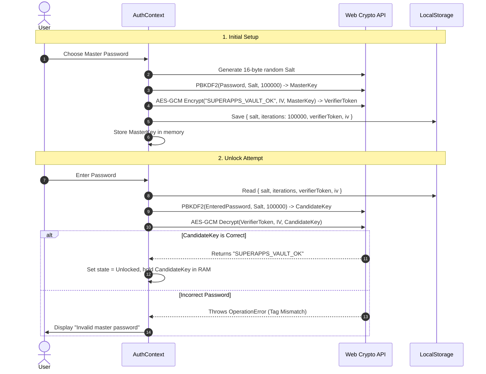

# Superapps OS — Cryptographic Specification

This document provides the mathematical specifications, cryptographic algorithms, key lifecycle procedures, and threat model analysis for **Superapps OS**.

---

## 🛡️ 1. Cryptographic Philosophy

Superapps OS employs a **Zero-Knowledge Architecture**:
- All cryptographic keys are derived locally in the user's web browser using standard W3C **Web Crypto API** (`window.crypto.subtle`).
- Plaintext data, passwords, and cryptographic keys are **never transmitted over the network**.
- Even if the hosting infrastructure (GitHub Pages) or network traffic is fully intercepted, no attacker can decrypt the user's notes, shortlinks, or financial records without the master password.

---

## 📐 2. Cryptographic Primitives & Specifications

### A. Key Derivation: PBKDF2 (RFC 2898 / RFC 8018)

| Parameter | Specification | Standard / Guidance |
| :--- | :--- | :--- |
| **KDF Algorithm** | PBKDF2 (Password-Based Key Derivation Function 2) | PKCS #5 v2.1 |
| **Pseudorandom Function (PRF)** | HMAC-SHA-256 | FIPS PUB 198-1 |
| **Iteration Count** | **100,000 rounds** | OWASP Password Storage Guidance |
| **Salt Length** | **16 bytes (128 bits)** | Cryptographically secure random (`crypto.getRandomValues`) |
| **Output Key Length** | **256 bits (32 bytes)** | AES-256 target key |

```text
DerivedKey = PBKDF2(
  PRF = HMAC-SHA256,
  Password = MasterPassword (UTF-8),
  Salt = CSPRNG(16 bytes),
  Iterations = 100,000,
  KeyLength = 256 bits
)
```

---

### B. Authenticated Encryption: AES-256-GCM (NIST SP 800-38D)

| Parameter | Specification | Standard / Guidance |
| :--- | :--- | :--- |
| **Cipher Algorithm** | AES (Advanced Encryption Standard) | FIPS 197 |
| **Cipher Mode** | GCM (Galois/Counter Mode) | NIST Special Publication 800-38D |
| **Key Size** | 256 bits (32 bytes) | Top Secret security margin |
| **Initialization Vector (IV)** | **12 bytes (96 bits)** | Unique CSPRNG per encryption operation |
| **Authentication Tag** | **128 bits (16 bytes)** | Guarantees ciphertext integrity and authenticity |

```text
(Ciphertext, AuthTag) = AES-256-GCM_Encrypt(
  Key = DerivedKey,
  IV = CSPRNG(12 bytes),
  Plaintext = UTF-8 Data or SQLite Binary Bytes
)
```

> **Integrity Guarantee**: AES-256-GCM will refuse to decrypt if any bit of the ciphertext or IV has been tampered with or corrupted, throwing an `OperationError`.

---

## 🔑 3. Vault Verification & Unlock Protocol

To verify that an entered master password is correct without storing the plaintext password or raw hash on disk:



---

## 📦 4. `.vault` Backup Container Specification

When exporting an encrypted backup file, the system packages the complete SQLite database binary into a standardized, versioned JSON container:

```json
{
  "format": "superapps-vault-v1",
  "version": 1,
  "kdf": {
    "algorithm": "PBKDF2",
    "hash": "SHA-256",
    "iterations": 100000,
    "salt": "a3f18e9c0b1274d9e5684a2f8b01c3d4"
  },
  "cipher": {
    "algorithm": "AES-256-GCM",
    "iv": "6b7d8e9f0a1c2e3d4f5a6b7c",
    "tagLength": 128
  },
  "ciphertext": "k7A2B9...[Base64 Encoded AES-GCM Encrypted SQLite Binary]...",
  "exportedAt": "2026-09-29T19:30:00.000Z"
}
```

### Portability & Future-Proofing
- Contains all parameters required to decrypt independently of Superapps OS.
- Can be decrypted using any programming language supporting standard WebCrypto / OpenSSL / SubtleCrypto:
  - Python: `cryptography.hazmat.primitives.ciphers.aead.AESGCM`
  - Node.js: `crypto.createDecipheriv('aes-256-gcm', ...)`
  - Go: `cipher.NewGCM(...)`

---

## ⏰ 5. Key Lifecycle & Memory Management

1. **Key Ephemerality**: Derived `CryptoKey` instances live exclusively in JavaScript engine memory. They are never written to `localStorage`, `sessionStorage`, or `IndexedDB`.
2. **Auto-Lock Timeout**: A browser idle timer tracks `mousedown`, `keydown`, `touchstart`, and `scroll` events. If the user is inactive for the chosen duration (default: 15 minutes), the `CryptoKey` reference is set to `null` and the UI reverts to the lock screen.
3. **Explicit Vault Lock**: Clicking the "Lock" button immediately wipes the in-memory key reference and forces garbage collection.

---

## 🎯 6. Threat Model & Security Evaluation

| Threat Vector | Severity | Vulnerability Level | Countermeasure in Superapps OS |
| :--- | :--- | :--- | :--- |
| **Server Interception / Compromised CDN** | High | **Zero** | GitHub Pages only serves static client code. It never sees encryption keys or plaintexts. |
| **Stolen Local Storage / IndexedDB Files** | High | **Low** | Verifier tokens are encrypted. Backups are encrypted with AES-256-GCM. Unencrypted local SQLite is protected by machine user account permissions. |
| **Offline Dictionary / Brute-Force Attack** | Medium | **Very Low** | 100,000 PBKDF2 iterations require massive GPU computing power per candidate password. |
| **Ciphertext Bit Flipping / Tampering** | Medium | **Zero** | AES-256-GCM provides authenticated integrity. Any modified byte fails tag verification immediately. |
| **Malicious Browser Extensions (XSS)** | Critical | **Moderate** | Standard browser sandbox caveat: Users must only run trusted extensions, as extensions with `<all_urls>` permissions can inspect page DOM. |
