# Superapps OS — Database Schema Reference

Superapps OS runs a complete relational **SQLite 3** database compiled to WebAssembly inside the browser, persisted to **IndexedDB** (`SuperappsVaultDB`).

---

## 🗄️ 1. Entity-Relationship Overview

```mermaid
erDiagram
    SHORTLINKS {
        string id PK
        string key UK "Shortcut alias (e.g. gh, mail)"
        string title "Descriptive title"
        string url "Destination URL"
        string category "Tag grouping"
        integer clicks "Click counter"
        string createdAt "ISO 8601 Timestamp"
        string updatedAt "ISO 8601 Timestamp"
    }

    NOTES {
        string id PK
        string title "Note title"
        string content "Markdown text payload"
        string category "Work, Personal, Ideas"
        integer isPinned "0 = normal, 1 = pinned"
        string createdAt "ISO 8601 Timestamp"
        string updatedAt "ISO 8601 Timestamp"
    }

    EXPENSES {
        string id PK
        string title "Transaction label"
        real amount "Monetary value"
        string type "expense | income"
        string category "Food, Tech, Salary, etc."
        string date "YYYY-MM-DD"
        string notes "Additional context"
        string createdAt "ISO 8601 Timestamp"
    }

    HABITS {
        string id PK
        string title "Habit routine name"
        string frequency "daily | weekly"
        integer streak "Consecutive completions"
        string completedDates "JSON array of YYYY-MM-DD"
        string createdAt "ISO 8601 Timestamp"
    }

    LOCAL_STASH {
        string id PK
        string name "File basename"
        integer size "File size in bytes"
        string type "MIME type"
        string dataBase64 "Raw Base64 data URI"
        string createdAt "ISO 8601 Timestamp"
        string expiresAt "Optional expiry date"
        string note "User description"
    }

    EPHEMERAL_UPLOADS {
        string id PK
        string name "Uploaded filename"
        integer size "Bytes"
        string url "Public Litterbox download URL"
        integer expiryHours "1 | 12 | 24 | 72"
        string uploadedAt "ISO 8601 Timestamp"
    }

    APP_SETTINGS {
        string key PK "Configuration key"
        string value "JSON or string payload"
    }
```



---

## 📊 2. Table Definitions & DDL

### A. `shortlinks`
Stores personal quick-jump bookmarks and launcher shortcuts (`go/<key>`).

```sql
CREATE TABLE IF NOT EXISTS shortlinks (
  id TEXT PRIMARY KEY,
  key TEXT UNIQUE,
  title TEXT,
  url TEXT,
  category TEXT,
  clicks INTEGER DEFAULT 0,
  createdAt TEXT,
  updatedAt TEXT
);
```

#### Key Queries:
```sql
-- Fetch all links sorted by most frequently clicked
SELECT id, key, title, url, clicks FROM shortlinks ORDER BY clicks DESC;

-- Increment click count on launch
UPDATE shortlinks SET clicks = clicks + 1, updatedAt = datetime('now') WHERE key = 'gh';
```

---

### B. `notes`
Stores distraction-free markdown notes, checklists, and documentation.

```sql
CREATE TABLE IF NOT EXISTS notes (
  id TEXT PRIMARY KEY,
  title TEXT,
  content TEXT,
  category TEXT,
  isPinned INTEGER DEFAULT 0,
  createdAt TEXT,
  updatedAt TEXT
);
```

#### Key Queries:
```sql
-- Retrieve notes with pinned notes prioritized first
SELECT * FROM notes ORDER BY isPinned DESC, updatedAt DESC;

-- Full-text keyword search
SELECT * FROM notes WHERE title LIKE '%api%' OR content LIKE '%api%';
```

---

### C. `expenses`
Stores personal and project financial ledger transactions.

```sql
CREATE TABLE IF NOT EXISTS expenses (
  id TEXT PRIMARY KEY,
  title TEXT,
  amount REAL,
  type TEXT,
  category TEXT,
  date TEXT,
  notes TEXT,
  createdAt TEXT
);
```

#### Key Queries:
```sql
-- Monthly expense total
SELECT SUM(amount) FROM expenses WHERE type = 'expense' AND date LIKE '2026-09%';

-- Breakdown by category
SELECT category, SUM(amount) as total FROM expenses WHERE type = 'expense' GROUP BY category ORDER BY total DESC;
```

---

### D. `habits`
Maintains daily habits, frequency definitions, and streak counters.

```sql
CREATE TABLE IF NOT EXISTS habits (
  id TEXT PRIMARY KEY,
  title TEXT,
  frequency TEXT,
  streak INTEGER DEFAULT 0,
  completedDates TEXT,
  createdAt TEXT
);
```

---

### E. `local_stash`
Stores offline files, tokens, and credentials directly inside browser SQLite as Base64 text.

```sql
CREATE TABLE IF NOT EXISTS local_stash (
  id TEXT PRIMARY KEY,
  name TEXT,
  size INTEGER,
  type TEXT,
  dataBase64 TEXT,
  createdAt TEXT,
  expiresAt TEXT,
  note TEXT
);
```

---

### F. `ephemeral_uploads`
Logs temporary files uploaded to Litterbox with their expiration timeframe.

```sql
CREATE TABLE IF NOT EXISTS ephemeral_uploads (
  id TEXT PRIMARY KEY,
  name TEXT,
  size INTEGER,
  url TEXT,
  expiryHours INTEGER,
  uploadedAt TEXT
);
```

---

## ⚡ 3. SQL Query Runner & Direct In-Browser Inspection

Superapps OS includes a live SQL console located at `/app/backup`:
- Users can run arbitrary SQL statements: `SELECT`, `INSERT`, `UPDATE`, `DELETE`, `PRAGMA`.
- Can inspect SQLite tables via `PRAGMA table_info(shortlinks);` or `SELECT name FROM sqlite_master WHERE type='table';`.
- Results render directly into an interactive data table with query duration metrics.
