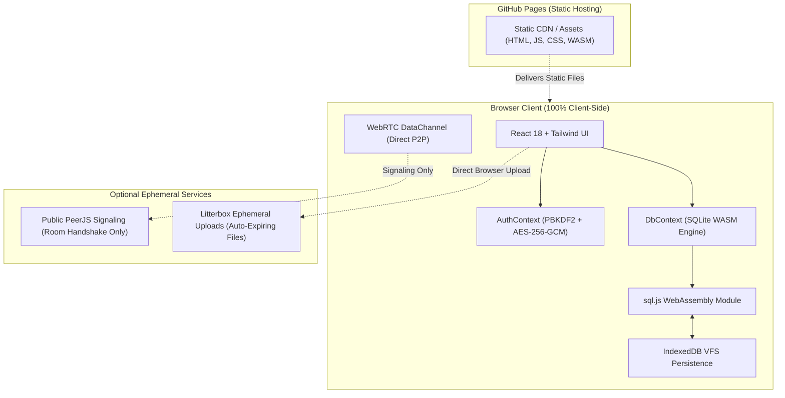

# Superapps OS — Technical Documentation

Welcome to the technical documentation for **Superapps OS**, a 100% client-side, zero-knowledge daily productivity and developer utility suite built for GitHub Pages.

---

## 📚 Documentation Index

| Document | Purpose | Audience |
| :--- | :--- | :--- |
| [**Developer Guide**](./DEVELOPER_GUIDE.md) | Setup, project layout, development workflow, testing, and tutorial on adding new mini-apps. | Engineers & Contributors |
| [**Architecture**](./ARCHITECTURE.md) | Deep architectural blueprint of client-side execution, SQLite WASM, IndexedDB VFS, and WebRTC streaming. | Architects & Engineers |
| [**Cryptography Specification**](./CRYPTOGRAPHY.md) | Bitwarden-grade zero-knowledge security model, PBKDF2, AES-256-GCM, and key lifecycle. | Security Engineers & Auditors |
| [**Database Schema**](./DATABASE_SCHEMA.md) | SQLite DDL schemas, table structures, indexes, queries, and migration patterns. | Database & Backend Engineers |

---

## ⚡ High-Level System Architecture

---

## 🎯 Core Technical Tenets

1. **Zero Server Backend**: The entire application is deployed statically on GitHub Pages. No Node.js server, Python backend, or serverless functions are required.
2. **True In-Browser Relational Database**: Powered by `sql.js` (SQLite compiled to WebAssembly), enabling real SQL queries, foreign keys, aggregations, and joins directly in the browser.
3. **Bitwarden-Grade Zero-Knowledge Security**: Data is encrypted using AES-256-GCM with keys derived via PBKDF2 (100,000 iterations). Plaintext data and keys never touch a remote server.
4. **Data Portability**: Complete control over your data with one-click password-protected `.vault` encrypted exports and raw `.sqlite3` binary downloads.
5. **Stateless Public Sharing**: Share compressed URLs without storing any record in any database or cloud server using client-side URL fragment decompression (`/#/r?d=...`).
